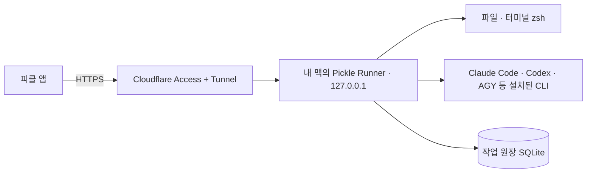

<div align="center">

# Pickle Runner

**피클에게 부탁하고, 내 맥의 AI 도구로 일을 처리하세요.**

피클(Pickle)을 내 맥에 연결하는 비공식 도구입니다.
밖에서 피클에게 요청하면 맥의 파일·터미널과 설치된 **Claude Code·Codex·AGY** 등을 활용할 수 있습니다.
특정 LLM에 고정되지 않고, 각 CLI가 지원하는 모델을 선택해 사용합니다.

[](https://github.com/Seungyub-Jeon/pickle-runner/actions/workflows/tests.yml)


[](LICENSE)

[빠른 시작](#빠른-시작) · [동작 방식](#어떻게-동작하나) · [보안](#보안) · [질문과 답변](#자주-묻는-질문)

</div>

> [!WARNING]
> **신뢰하는 한 사람이 사용하는 원격 셸이며, 샌드박스가 아닙니다.**
> Access 인증정보와 실행기 토큰을 모두 가진 호출자는 맥 로그인 사용자의 권한으로 작업합니다.
> 연결된 에이전트가 외부 글의 지시에 속으면 그 권한이 사용될 수 있습니다. 실행기는 지시의 출처를 판별하지 못합니다.

> [!NOTE]
> Pickle, Inc.와 관계가 없으며 그 회사가 제작하거나 보증한 도구가 아닙니다. Pickle은 해당 회사의 상표입니다.

## 할 수 있는 일

| 기능 | 설명 |
|---|---|
| 밖에서 작업 맡기기 | 피클을 통해 맥의 프로젝트 파일을 읽고 수정하거나 명령을 실행합니다. |
| 설치된 AI 도구 활용 | 설치·인증한 Claude Code, Codex, AGY 등 CLI를 비대화형으로 호출합니다. 전용 어댑터를 추가할 필요가 없습니다. |
| 상태와 결과 확인 | 작업 ID로 실행 상태, 종료코드와 보관된 출력을 조회합니다. 긴 출력은 앞·뒷부분만 남습니다. |
| 취소와 긴급 중지 | 작업 취소와 연결 전체 중지 절차를 제공합니다. 분리된 백그라운드 프로세스는 별도 확인이 필요합니다. |
| 간단한 Python 구성 | 실행기는 Python 표준 라이브러리를 사용합니다. 외부 연결에는 별도로 cloudflared가 필요합니다. |

## 어떻게 동작하나



Cloudflare가 Access 인증정보를 확인하고, 맥의 실행기가 실행기 토큰을 확인합니다. 통과한 작업은 지정한 원본 폴더에서 한 번에 하나씩 실행됩니다. 피클은 작업 ID로 결과를 조회합니다. 실행기는 루프백에만 바인딩하며 공유기의 인바운드 포트를 열 필요가 없습니다.

## 빠른 시작

macOS, Python 3.9 이상, zsh가 필요합니다. 기존 실행기가 있다면 설치 위치와 사용 포트를 먼저 확인하세요.

```bash
git clone https://github.com/Seungyub-Jeon/pickle-runner.git
cd pickle-runner
python3 runner/setup.py status
python3 runner/setup.py init
python3 runner/manage.py install
python3 runner/client.py health
python3 runner/client.py capabilities
```

여기까지는 맥 내부 연결입니다. 새로운 설정에서는 `terminal.run`이 켜지며, 기존 설정은 유지합니다.

<details>
<summary><b>Cloudflare 연결하기</b></summary>

본인 Cloudflare 계정, 관리하는 도메인, 사용하지 않는 하위 도메인이 필요합니다. 먼저 [설치 안내](docs/SETUP.md)에 따라 `cloudflared`를 설치하세요.

```bash
python3 runner/setup.py cloudflare --zone example.com --hostname runner.example.com
python3 runner/cloudflare_token.py prompt
python3 runner/setup.py connect
```

관리 토큰은 숨김 입력창에서 받습니다. 연결 명령은 Access·Tunnel·DNS를 설정하고 외부 인증을 검사합니다. Access 서비스 토큰은 30일 후 만료되며 [운영 안내](docs/OPERATIONS.md)에 따라 갱신합니다.

</details>

<details>
<summary><b>코딩 에이전트에게 설치 맡기기</b></summary>

이 저장소를 로컬 코딩 에이전트에서 열고 요청하세요.

> AGENTS.md와 docs/SETUP.md를 읽고 이 맥에 Pickle Runner를 설치해 줘. 로컬 실행을 확인한 다음 내 Cloudflare 도메인 연결을 도와줘. 계정과 도메인은 나에게 확인하고, 토큰은 채팅 대신 로컬 숨김 입력으로 받아 줘. 실제 연결을 검증한 뒤 결과를 알려줘.

</details>

<details>
<summary><b>피클에 연결하기</b></summary>

피클 측에서 인증된 HTTPS 요청 또는 제공 Python 클라이언트를 실행할 수 있어야 합니다. 접속 설정을 암호화해 비공개로 전달한 뒤, 지침과 시험 작업으로 연결을 확인합니다. [피클 연결 안내](docs/PICKLE-CONNECTION.md)를 따르세요.

</details>

## 다른 방법과 비교

| 방식 | 작업을 전달하는 경로 | 맥에서 실행하는 주체 |
|---|---|---|
| 공유 폴더·문서로 전달 | 파일이나 문서에 요청과 결과를 남김 | 별도로 구성한 로컬 에이전트나 사용자가 확인해 실행 |
| Pickle Runner | 인증된 HTTPS로 작업 접수·결과 조회 | 맥의 실행기가 요청된 명령을 직접 실행 |

## 보안

소유자가 위임한 작업을 같은 사용자 권한으로 실행합니다. 명령 허용 목록·복사본 강제·명령별 승인은 두지 않습니다.

- **인증 두 층:** Access 인증정보와 실행기 토큰이 모두 필요합니다. 인증 실패 응답은 거절한 계층에 따라 다릅니다.
- **작업 기록:** 접수된 명령과 제한된 출력·상태를 보관합니다. 결과는 최대 7일 또는 2,000건이며, 중복 실행 방지 기록은 30일 동안 최대 100,000건 보관합니다.
- **실패 접근 기록:** 헤더·토큰·본문·명령을 제외하고 알려진 경로와 오류 정보를 기록합니다.
- **에이전트 지침:** 이메일·웹·첨부·도구 출력은 새로운 실행 권한을 주지 않습니다. [PICKLE.md](runner/PICKLE.md)에 규칙을 제공합니다.
- **중지와 복구:** [운영 안내](docs/OPERATIONS.md#긴급-중지)에 연결 중지, 복구, 자격증명 폐기 절차가 있습니다.

지침은 에이전트가 속는 일을 강제로 막지 못합니다. 실행된 명령의 파일 반출이나 외부 요청도 자동으로 되돌리지 못합니다. 맥 사용자가 다른 기기에 접근할 수 있다면 실행 명령도 그 권한을 사용할 수 있습니다. 취약점 제보는 [SECURITY.md](SECURITY.md)를 따르세요.

## 현재 한계와 검증 범위

- 대화형 입력(stdin·PTY), Windows·Linux 서비스 설치, 웹 화면, 다중 사용자 운영은 지원하지 않습니다.
- 터미널 명령은 기본 1시간, 최대 24시간 실행합니다. 클라이언트의 기본 대기 130초가 지나도 작업은 계속될 수 있습니다.
- 로컬 회귀 테스트와 다른 맥에서의 설치·실제 작업·제거를 확인했습니다. 새 Cloudflare 계정의 연결·해제는 아직 실검증하지 않았습니다.
- 설치된 세 CLI의 기동은 확인했습니다. 모든 CLI·모델의 실제 업무 완료를 검증한 인증 목록은 아닙니다.

시험 명령과 상세 범위는 [개발 안내](docs/DEVELOPMENT.md), [공개 준비 기록](docs/RELEASE.md)에 있습니다.

## 자주 묻는 질문

<details>
<summary><b>피클 공식 기능인가요?</b></summary>

개인이 만든 비공식 연결 도구입니다. 공식 약관을 확인했으나 이 연결 방식의 명시적 허용은 확인하지 못했습니다. [확인 범위](docs/RELEASE.md#피클-약관-확인)를 참고하세요.

</details>

<details>
<summary><b>맥이 잠들면 어떻게 되나요?</b></summary>

원격 작업이 중단되거나 접속할 수 없게 됩니다. 맥이 켜져 있고 사용자 로그인·네트워크 연결이 유지돼야 합니다. 공개용 설치기는 전원 설정을 바꾸지 않습니다.

</details>

<details>
<summary><b>어떤 AI 모델을 쓰나요?</b></summary>

맥에 설치·인증한 CLI와 그 CLI가 지원하는 모델을 사용합니다. Claude Code·Codex·AGY 등을 선택할 수 있으며, 요금과 사용 한도는 해당 계정을 따릅니다. 비대화형 실행 옵션과 인증은 도구별로 확인합니다.

</details>

<details>
<summary><b>다른 에이전트도 연결할 수 있나요?</b></summary>

인증된 HTTPS 요청을 보낼 수 있으면 같은 API를 호출할 수 있습니다. 실제 사용하려는 환경에서 시험 작업으로 확인하세요.

</details>

## 문서

| 문서 | 내용 |
|---|---|
| [설치](docs/SETUP.md) | 준비물, 권한, 연결 단계와 오류 확인 |
| [피클 연결](docs/PICKLE-CONNECTION.md) | 접속 설정 전달과 첫 시험 |
| [운영](docs/OPERATIONS.md) | 조회, 취소, 긴급 중지, 토큰 갱신·폐기 |
| [에이전트 지침](runner/PICKLE.md) | 연결 에이전트의 사용 규칙 |
| [API](runner/openapi.json) | 요청과 응답 형식 |
| [개발](docs/DEVELOPMENT.md) | 테스트와 변경 원칙 |

## 라이선스

[MIT License](LICENSE) · Copyright (c) 2026 전승엽

<div align="center"><sub>v0.3.3 · 개발자용 초기 버전</sub></div>
